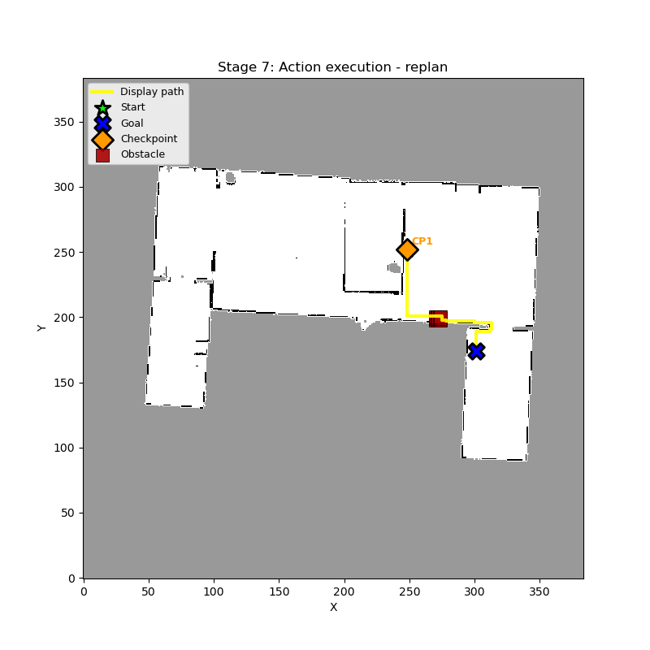
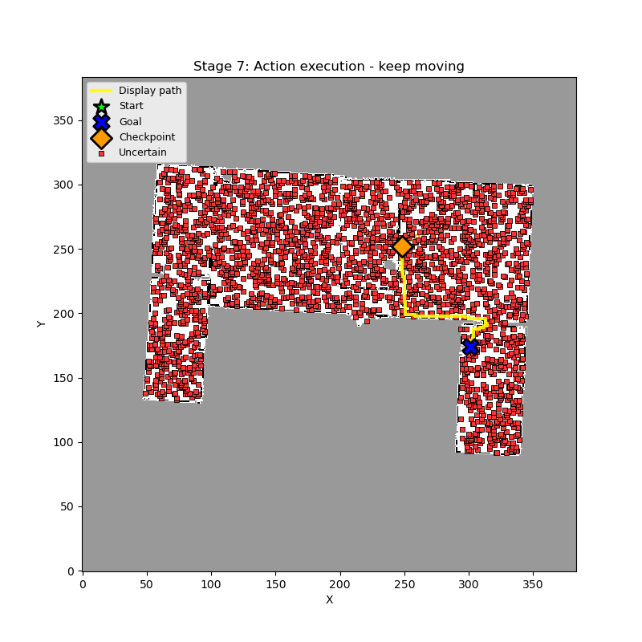

# LLM-Guided Navigation Under Temporal Map Corruption

A grid-navigation system in which a language model decides how a robot should react when its map observations go bad. Given a short history of local map patches, the LLM classifies what it is seeing and picks one of three actions: **keep moving**, **wait and re-inspect**, or **replan**. A skill memory stores completed path segments so later missions can reuse them instead of searching from scratch.

| Blocked, moving obstacle | Blocked, permanent obstacle |
|:---:|:---:|
|  |  |
| **Uncertain, sparse noise** | **Uncertain, clustered region** |
|  |  |

*Stages of the integrated pipeline on the `house` occupancy map (seed 1110): a stored path segment (orange checkpoint) is reused, then corruption appears on the remaining route and the LLM decides what to do.*

## How it works

The robot plans with A* on a 2-D occupancy grid. Observations of cells ahead are corrupted over several timesteps in one of four ways, and the LLM has to tell them apart:

| Mode | What the robot sees | Expected decision |
|---|---|---|
| `uncertain_sparse` | Scattered unknown (`-1`) cells that move between timesteps | keep moving |
| `uncertain_clustered` | A dense region of unknown cells that persists | replan |
| `blocked_moving` | Occupied (`1`) cells that move across the path | wait and re-inspect |
| `blocked_permanent` | Occupied cells that stay put | replan |

Per decision step:

1. Extract a 7x7 patch around the cells of interest for each timestep.
2. Build a prompt from the patch history, robot pose, goal and any matching stored skills.
3. Query the LLM and parse the JSON reply (`label`, `movement_pattern`, `confidence`, `reason`, `recommended_action`).
4. Apply the action: continue along the path, advance a timestep and look again, or penalise the region and re-run A*.

Completed segments are stored in a **skill library**. A new mission is matched against stored skills with a weighted similarity score (45% start-patch overlap, 20% goal direction, 20% turn pattern, 15% path length), and a matching skill biases the cost map toward its path.

## Results

All numbers come from the files in [`results/`](results/) and use the bundled `house` map. Sample sizes are small, so treat them as indicative, not as benchmarks.

**LLM temporal-obstacle classification** ([`llm_dynamic_obstacle.csv`](results/llm_dynamic_obstacle.csv), 5 trials per mode). A trial counts as correct when the LLM's action matches the expected decision in the table above.

| Mode | Correct |
|---|---|
| `uncertain_sparse` | 3 / 5 |
| `uncertain_clustered` | 4 / 5 |
| `blocked_moving` | 3 / 5 |
| `blocked_permanent` | 2 / 5 |
| **Total** | **12 / 20 (60%)** |

The most common error is calling a static blockage "moving" (and vice versa), which is exactly the distinction the temporal patches are meant to expose.

**Sparse vs. clustered uncertainty** ([`llm_targeted.csv`](results/llm_targeted.csv)): 6 / 10 correct (sparse 2 / 5, clustered 4 / 5).

**Kalman-filter baseline** ([`kalman_results.csv`](results/kalman_results.csv)). A per-cell Kalman occupancy filter followed by A*, with no language model, on 30 trials of uncertain observations. It always finds a path, but only 6 / 30 (20%) of those paths are valid on the true map (sparse 3 / 15, clustered 3 / 15).

**Skill reuse** ([`reuse_results.json`](results/reuse_results.json)). 10 missions seed a library of 52 path segments; 46 of the 90 later missions (51.1%) could reuse at least one stored segment, covering 4,766 cells in total.

**End-to-end simulator** ([`experiment_results.csv`](results/experiment_results.csv)). 40 trials (10 per mode): every trial ended with a valid path to the goal. This is a pipeline sanity check rather than a performance measure, since the simulator accepts any trial where a path exists at the end.

## Repository layout

```
src/final_proj/          ROS 2 (ament_python) package, also installable with pip
  final_proj/
    environment/         map loading, corruption models, patch extraction
    llm/                 prompt builder, Groq client with offline stub, response parser
    planning/            A*, cost maps, LLM-driven replanner
    memory/              skill store and similarity scoring
    nodes/               ROS 2 nodes (nav_node, orchestrator)
    data/                occupancy map (map.yaml, house.pgm) and skills.json
experiments/             runnable scripts that produced the results
tests/                   pytest unit tests
results/                 CSV / JSON outputs from the experiments
docs/figures/            figures used in this README
```

## Getting started

Requires Python 3.10+.

```bash
git clone https://github.com/SreshthTiwari/LLMRobotNav.git
cd LLMRobotNav
python3 -m venv .venv && source .venv/bin/activate
pip install -r requirements-dev.txt
pip install -e src/final_proj
pytest
```

By default the LLM client uses a **local rule-based stub**, so everything runs offline with no API key. To use a real model, install `groq` (already in `requirements.txt`) and set `GROQ_API_KEY`; the default model is `llama-3.1-8b-instant`.

## Running the experiments

Run all commands from the repository root. Add `--no-window` to any script that draws figures if you are on a headless machine.

```bash
# Step through one scenario (modes: uncertain_sparse, uncertain_clustered, blocked_moving, blocked_permanent)
python experiments/test_llm_full_pipeline.py --mode blocked_moving --seed 99

# Skill reuse followed by LLM replanning, stage by stage
python experiments/full_integrated_test.py --mode uncertain_sparse --seed 1110

# Batch: 10 trials per mode, saved as CSV
python experiments/llm_experiments.py --no-window --trials-per-mode 10 --seed 1 --csv-output results/experiment_results.csv

# LLM decision accuracy per corruption mode
python experiments/test_llm_dynamic_blockage.py --output results/llm_dynamic_obstacle_rerun.csv

# Kalman baseline
python experiments/test_kalman_baseline.py --trials 30 --csv results/kalman_results.csv

# Skill reuse across 100 missions (10 seed the library)
python experiments/test_skill_reuse_potential.py --num-missions 100 --initial-batch 10 --seed 42 --output results/reuse_results.json

# Baseline A* vs. corrupted map vs. full system
python experiments/evaluation.py --scenarios 5 --trials 3
```

The other scripts in `experiments/` cover skill storage and space savings (`test_skill_storage.py`, `test_skill_space_savings.py`), targeted sparse-vs-clustered tests (`test_llm_targeted.py`), and skill storage combined with the LLM (`test_llm_skill_storage_integration.py`). Runs with the same `--seed` are repeatable when the stub client is used.

### ROS 2

The package also builds with colcon (`nav_node` and `orchestrator` entry points); this needs a ROS 2 installation with `rclpy`, `nav_msgs` and `geometry_msgs`.

```bash
colcon build --packages-select final_proj
```

## Limitations

- The map is a single static floor plan, and corruption is synthetic, not recorded sensor data.
- Each mode has only 5-10 trials, so the accuracy figures have wide error bars.
- The LLM only sees local 7x7 patches, so ambiguous cases (a slow-moving obstacle vs. a static one) are hard to separate.

## License

MIT. See [LICENSE](LICENSE).
